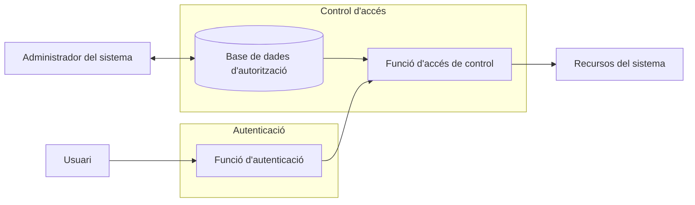

# Seguretat lògica

La **seguretat lògica** complementa els elements de la seguretat passiva. El seu objectiu principal és el **control d'accés** als sistemes informàtics, que implica verificar la identitat d'una persona abans de concedir-li permís per accedir a llocs, dades o programes concrets.

Aquestes mesures formen part integral de la cadena de seguretat. Per concretar els drets d'accés d'una persona al sistema s'utilitzen estructures lògiques com les **matrius de control d'accés** i les **llistes de control d'accés (ACL)**.

Abans d'aplicar qualsevol permís, cal **autenticar** l'usuari. El mètode d'autenticació més habitual és mitjançant contrasenyes, la fortalesa de les quals depèn de l'aplicació d'una bona política de contrasenyes.

## Elements bàsics de control d'accés

El **control d'accés** és una mesura fonamental de la seguretat informàtica per protegir la informació: determina **qui o què** pot accedir als recursos del sistema i **amb quin tipus de permís**.

## Autenticació i autorització

### Autenticació

És el pas inicial: la verificació de la identitat d'una entitat (usuari, programa, etc.) que vol accedir al sistema.

- **Funció:** determina si l'usuari pot entrar al sistema o ha de quedar-se fora.

### Autorització i control d'accés

Un cop autenticat, l'usuari passa al procés d'**autorització**, que és implementat pel **control d'accés**.

- **Autorització:** és la concessió d'un dret o permís a l'entitat per accedir a un recurs específic del sistema.
- **Control d'accés:** consulta la base de dades d'autorització (mantinguda per l'administrador) per determinar quin tipus d'accés té l'usuari al recurs sol·licitat.

En resum, l'autenticació permet l'entrada al sistema, i el control d'accés basat en l'autorització determina l'accés permès als recursos interns. Aquesta funció de control d'accés pot ser duta a terme per un o diversos components del sistema.

### Esquema d'autenticació

## Objectes, subjectes i drets d'accés

- **Objecte:** és un recurs que té l'accés controlat. És una entitat per emmagatzemar i/o rebre informació.
  *Exemple:* fitxers, directoris i programes.
- **Subjecte:** és una entitat capaç d'accedir a objectes. Quan un usuari o aplicació vol accedir a un objecte, en realitat ho fa per mitjà d'un procés que representa l'usuari o aplicació concrets. Tot i així, és habitual parlar d'usuaris com a subjectes.

### Classes de subjectes

Normalment es defineixen tres classes de subjectes, amb diferents drets d'accés per a cada classe:

- **Propietari:** podria ser el creador d'un recurs, com un fitxer o directori.
- **Grup:** a més dels privilegis assignats a un propietari, un grup concret d'usuaris també pot tenir privilegis d'accés a determinats recursos. En molts casos, un usuari pot pertànyer a diversos grups.
- **Altres:** un nombre més petit d'accessos es concedeix a usuaris que han entrat al sistema però que no pertanyen a la categoria de propietari o de grup per a un recurs determinat.

Un **dret d'accés** indica de quina manera un subjecte pot accedir a un objecte.

### Classes de drets d'accés

| Dret | Què permet |
|---|---|
| **Lectura** | Visualitzar la informació d'un recurs donat (fitxer, directori, registre…). L'accés de lectura permet copiar o imprimir recursos. |
| **Escriptura** | Afegir, modificar o eliminar dades d'un recurs donat. |
| **Execució** | Executar programes específics. |
| **Esborrament** | Eliminar certs recursos, com fitxers o registres. |
| **Creació** | Crear nous fitxers, registres o directoris. |

## Política de control d'accés

Una **política de control d'accés** és el conjunt de normes, plasmades a la base de dades d'autorització, que defineixen **qui o què** pot accedir als recursos, **quin tipus d'accés** se li permet i **en quines circumstàncies**.

### Control d'accés discrecional (DAC)

El **control d'accés discrecional (DAC)** és una política de control d'accés que es basa en la identitat del sol·licitant i en unes normes d'accés (autoritzacions) que determinen les seves accions permeses.

- El terme *discrecional* implica que un subjecte que ja té drets d'accés sobre un recurs pot, a la seva discreció, **concedir (o delegar)** aquests mateixos drets d'accés a un altre subjecte.

*Exemple:* l'acció de compartir un document que tenim al nostre Drive i especificar-ne els permisos de lectura o edició.

### Matriu de control d'accés

La **matriu de control d'accés (ACM)** és una implementació freqüent del DAC. És una taula on:

- les **files** representen els subjectes (usuaris, programes, etc.),
- les **columnes** representen els objectes (recursos, fitxers, etc.),
- la **intersecció** d'una fila i una columna (la cel·la) conté els drets d'accés específics que té el subjecte sobre aquell objecte.

Llegenda: **r** = autorització de lectura · **w** = autorització d'escriptura · **x** = autorització d'execució.

| | Objecte₁ | Objecte₂ | Objecte₃ | … | Objecteₘ |
|---|:-:|:-:|:-:|:-:|:-:|
| **Usuari₁** | rwx | rw | rwx | … | rw |
| **Usuari₂** | x | r | x | … | rw |
| **Usuari₃** | x | rw | rwx | … | r |
| **…** | … | … | … | … | … |
| **Usuariₙ** | x | rw | x | … | w |
