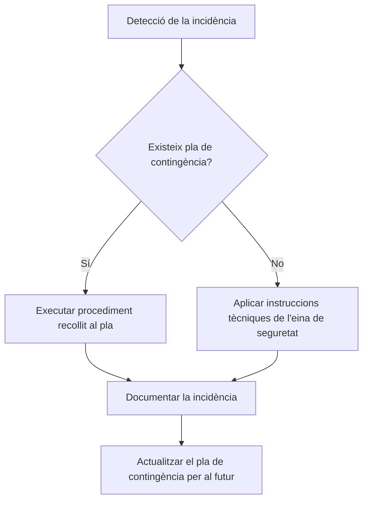

# Alarmes, detecció d'intrusions i gestió d'incidències

## Detecció d'intrusions: IDS vs IPS

Dins de la seguretat activa s'utilitzen eines especialitzades per monitorar el trànsit de xarxa:

**IDS (Sistema de Detecció d'Intrusions)**
:   Eina que vigila la xarxa o el sistema per detectar activitats sospitoses.
    *Analogia:* És com una alarma amb sensors de moviment que avisa si algú entra o intenta forçar una finestra.

**IPS (Sistema de Prevenció d'Intrusions)**
:   Evolució activa de l'IDS que no només detecta, sinó que actua immediatament per bloquejar l'amenaça.
    *Analogia:* És com un vigilant de seguretat que atura l'intrús a l'instant abans que pugui causar danys.

## Canals de detecció d'incidències

1. **Alarmes automàtiques del sistema:** Alertes generades per l'antivirus, el tallafocs o sistemes IDS/IPS.
2. **Comportament anòmal del sistema:**
    - Aparició o desaparició inexplicada d'arxius.
    - Alentiment general de l'equip o ús d'un disc dur sense activitat d'usuari.
    - Errors inesperats o tancaments de l'ordinador.

## Protocol d'actuació i documentació

!!! note "Documentació"
    Tota incidència resolta que no estigués prevista inicialment s'ha d'incorporar al pla de contingència per millorar la resposta en situacions futures.